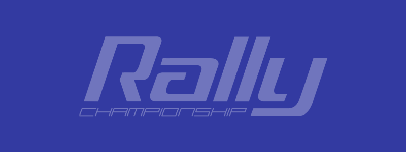

# Rally Championship 2000 Decomp

This project was written with AI coding assistants (Claude) under the maintainer's
direction. The port was compared with the original game function by function, and later
changes are checked with recorded races and replays and in play on PCs and the handheld.

A reimplementation in Rust of *Rally Championship 2000* (developed by Magnetic Fields; the
program `RAL.EXE`). It is a complete program of its own, `rc2k`: none of the original's code runs.
It reads the game's data files from the player's own copy of the game. No part of the
game is included here, but for its icon and its main menu's background picture, which stand
as the project's icon and banner (`assets/`).

## How it came about

The original was ported one function at a time. Each Rust function was loaded into the
running game in place of the original one and compared with it, until every function
the game reaches was ported and the two behaved alike. The hooks were then
removed and the code converted, module by module, into typed and mostly safe Rust with
nothing left that depends on the original's memory layout, on 32 bits or on Windows. The
platform side (DirectDraw, Direct3D, DirectSound, DirectInput, DirectPlay, the film player)
was not ported one to one: SDL3, a GPU renderer and the project's own film decoders stand in for it.

The game itself is meant to stay the same for the player: the same menus, physics, stages,
replays and save files. Where the original had bugs, they are fixed (see below).

## What works

- The whole game: menus, every stage, single rallies, championships, the arcade mode,
  split screen, replays, pace notes, the intro films, 3D sound, controllers.
- Network play, standalone to standalone, over TCP/IP or through Steam (lobbies, friends'
  invites, no ports to open; needs Valve's Steam library beside the program and the Steam
  client running: see the wiki's Network play page). The original's DirectPlay is replaced by a
  protocol of our own, so it does not play against the original program.
- The installer and uninstaller, working from the files of the CD (or of a download of
  it).
- The developers' debug pages, brought back as a window over the game (Ctrl+F11; Ctrl+F12
  freezes a race). Not in the 32-bit Windows build, on the handheld, on phones or in the
  web build.
- Old replays and save files are read as they are.

Platforms:

| Platform | State |
| --- | --- |
| Windows, 64 and 32 bits | Built and run (under Wine / Proton during development). |
| Linux, x86-64 | Built and run. One program with SDL linked in; it needs only glibc. |
| macOS, Intel and Apple silicon | Builds as `Rally Championship.app`. Tested less than the others. |
| Anbernic RG34XXSP (handheld, 64-bit ARM Linux) | Built and run on Knulli and on the stock system. |
| Steam Deck (and other x86-64 Linux with glibc 2.35 or later) | Built in a container of Ubuntu 22.04, for the Deck's processor. Not yet run on a real Deck. |
| Android (64-bit ARM; x86-64 for the emulator) | Built and run on phones, with touch controls. See [wiki: Android](wiki/Android.md). |
| iPhone and iPad (iOS 13 or later) | Built and run on an iPhone, with touch controls. The app is not signed: the player sideloads it. See [wiki: iOS](wiki/iOS.md). |
| Web (WebAssembly) | Experimental: menus and races play in a desktop browser (WebGL 2, gamepads, sound); no network play. |

How to install each one is under [Installing](#installing).

Races are drawn on the GPU where one can be started (SDL's GPU device on the desktop,
OpenGL on a PC without one, OpenGL ES on the handheld), otherwise by a software rasteriser. `--renderer software`
(or `RC2K_RENDERER=software`) forces the rasteriser.

Measured figures:

- On a desktop, a comparison with the original under the same conditions
  had both hold the frame rate; with the GPU renderer this program used between a seventh
  (Linux) and a third (Windows under Proton) of the original's processor time.
- On the handheld (four Cortex-A53 cores, Mali-G31) a night stage ran at about 47 frames
  a second and a stage in rain at about 42 (computer driver).

## Requirements

| Platform | Needs |
| --- | --- |
| Windows, 64 or 32 bits | Windows 10 or later (the minimum of the pinned Rust toolchain's Windows targets). |
| Linux, x86-64 | glibc only; which version depends on the system the program was built on. The released builds are made on Ubuntu 24.04 and need glibc 2.38 or later; a build made on a current rolling distribution needed 2.43. `./build.sh linux` prints the version its build needs. |
| macOS | macOS 11.0 (Big Sur) or later, Intel or Apple silicon. |
| Anbernic RG34XXSP | Knulli or the stock system; glibc 2.35 or later. |
| Steam Deck | SteamOS 3 (glibc 2.35 or later) and a processor with AVX2. |
| Android | Android 8.0 or later, 64 bits (not yet run on Android 9 and older). |
| iPhone / iPad | iOS 13 or later, and a way to sideload the app (AltStore, with an Apple ID and a computer). |
| Web | A desktop browser with WebAssembly threads; WebGL 2 for the GPU renderer (without it the software rasteriser draws). |

Graphics: on the desktop the GPU renderer goes through SDL's GPU device with Vulkan
(Windows, Linux) or Metal (macOS). Where no such device starts, OpenGL 3.3 draws the 3D
(shown on a window of its own), and where that does not start either, the software rasteriser
draws the game and needs no GPU. On the handheld the GPU renderer needs OpenGL ES 3.0
(the system's `libmali`), with the same fallback.

### Deliberate differences from the original

- No registry: the installation's record is the file `var\install.cfg` in the game's
  folder, so an installed folder can be moved or copied.
- The installer has no page for the kind of installation (it is always the full one), no
  DirectX set-up and no registration; it makes ordinary shortcuts.
- The installer takes the game from the folder it is started in, in place of asking for
  the CD.
- Network play uses its own protocol (see above).
- "Uninstall Rally" runs the installed program itself (`rc2k -u`).

## Installing

The program is only the engine. You need your own copy of the game: the files of its CD
(the folder that holds the CD's `FILES` folder; a copy of the CD or a download of it), or
a folder where the game is already installed (it holds `files` and `var`).

Builds are on this repository's releases page, one zip per platform, or you build one
yourself (below). The wiki's [Installing the game](wiki/Installing-the-game.md) page has
every platform's steps in full; in short:

| Platform | Download | Steps |
| --- | --- | --- |
| Windows (64 bits) | `rc2k-windows-x64.zip` | [below](#windows-linux-and-macos) |
| Linux | `rc2k-linux-x64.zip` | [below](#windows-linux-and-macos) |
| macOS | `rc2k-macos.zip` | [below](#windows-linux-and-macos) |
| Steam Deck | `rc2k-deck.zip` | [below](#steam-deck) |
| Anbernic RG34XXSP | `rc2k-handheld.zip` | [below](#anbernic-rg34xxsp-knulli) |
| Android | `rc2k-android.zip` | [below](#android) |
| iPhone / iPad | `rc2k-ios.zip` | [below](#iphone-and-ipad) |
| Web | `rc2k-web.zip` | [below](#web) |

The macOS and iOS builds are made only for stable releases (the main branch), not for the
experimental ones. A 32-bit Windows program is not released: build it yourself.

### Windows, Linux and macOS

1. Unzip the build into the folder that holds the CD's files:
   - Windows: `rc2k.exe` and `SDL3.dll`;
   - Linux: `rc2k` (`chmod +x rc2k` if it is not executable);
   - macOS: `Rally Championship.app`.
2. Start it there. Found among the CD's files with no installation, it opens the game's
   installer: choose the language and the folder, and it copies the game, itself included,
   adds the menu entries ("Rally", "Uninstall Rally", "View Readme"; on macOS the installed
   application is the entry) and starts the installed copy.

The program can also be started anywhere else: in a folder with no game data it opens a
page that asks for the game's folder or a zip of it (pick one, or drop it on the window).
`--game-data <folder or zip>` names it on the command line.

The folder offered by default:

| System | Folder |
| --- | --- |
| Windows | chosen on the installer's drive and folder pages |
| Linux | `$XDG_DATA_HOME/rally-championship` (usually `~/.local/share/rally-championship`) |
| macOS | `/Applications/Rally Championship.app` (the game's files inside it); what the game writes goes to `~/Library/Application Support/Rally Championship` |

Afterwards, start the game from the menu entry, or run `rc2k` in the installed folder.
The program writes its log to `rc2k.log` in the folder it runs in. To remove the game, use
"Uninstall Rally" (it asks whether to keep the saved games).

An existing installation of the original game also works without the installer: put the
program into the folder that holds `files` and `var` and start it there.

On macOS the application is signed ad hoc and not notarised, so the first start may have
to be allowed in the system's security settings.

### Steam Deck

The Deck's build is a Linux program made for SteamOS (`rc2k` and the starter `rally.sh`).
In desktop mode, install it as on Linux: unzip it into the folder with the CD's files,
start `rc2k` there, and the installer runs. Then, to start the game
from gaming mode, add `rally.sh` from the installed folder
(`~/.local/share/rally-championship` by default) to Steam with "Add a Non-Steam Game".
The installer does not copy `rally.sh`: copy it into the installed folder yourself.
This build has not yet been run on a real Deck. More:
[Installing the game](wiki/Installing-the-game.md#steam-deck).

### Anbernic RG34XXSP (Knulli)

There is no installer on the handheld. Install the game on a PC first, then copy that
installed folder's `files`, `var` and `savedata` and the build's files to the device's
ports folder over SSH:

```sh
# in the installed game's folder on the PC
tar cf - files var savedata | ssh root@address 'mkdir -p /userdata/roms/ports/rally; tar xf - -C /userdata/roms/ports/rally'
# in the folder of the unzipped build (or dist/handheld/)
scp rc2k root@address:/userdata/roms/ports/rally/
scp Rally.sh root@address:/userdata/roms/ports/
```

The game then appears under Ports as "Rally"; MENU + START leaves it. More:
[Installing the game](wiki/Installing-the-game.md#anbernic-rg34xxsp-knulli) and
[tools/anbernic/README.md](tools/anbernic/README.md).

### Android

Install `rc2k-arm64.apk` from the zip (the phone asks to allow installing from that
source). The app holds no game data and has no installer: at its first start it shows a
page with a "Pick a zip file" button; pick a zip of the game's folder and the app unpacks
it into its own storage. That page's file picker has not been tried on a phone yet; the
way that has been tested needs a computer with `adb` and a build you make yourself.
Both ways: [wiki: Android](wiki/Android.md#installing).

### iPhone and iPad

The `.ipa` is not signed and is not in the App Store. Sideload it with
[AltStore](https://altstore.io), which signs it with your own Apple ID:

1. Install AltServer on a Windows PC or a Mac, and with it AltStore on the phone.
2. Get `Rally Championship.ipa` (in `rc2k-ios.zip`) onto the phone, and in AltStore's
   "My Apps" tap + and choose it.
3. Open the app once, then copy the game's folder, or a zip of it, into the Files app
   under On My iPhone, Rally Championship, and open the app again.

With a free Apple ID the app has to be refreshed every 7 days (AltStore does it). The
steps in full, and installing from Linux without AltStore: [wiki: iOS](wiki/iOS.md#installing).

### Web

Experimental. Unzip `rc2k-web.zip`, run `python3 serve.py` in its folder and open
`http://127.0.0.1:8000/` in a desktop browser. The page asks for the game's folder or its
zip and keeps a copy in the browser's storage: the CD's files run the installer there, an
installed folder is played as it is. Nothing is uploaded. The saves live in the browser's
storage, which a browser may clear: the page's "export or import" link saves them as a
zip. More: [Installing the game](wiki/Installing-the-game.md#web).

### Starting straight into a race

Switches on the command line skip the menus and start a single rally stage, as if it had been
chosen there; afterwards come its results and the menus. `--replay` plays a saved replay the
same way. `rc2k --help` lists every switch.

```sh
rc2k --stage langton
rc2k --stage "hamiltons folly" --car felicia --gearbox manual --players 2 --seed 42
rc2k --replay 0
```

Stages and cars go by their English names, and a part of a name is enough when only one name
holds it. Every switch, the launch files and the rest of the command line are in the wiki's
[Running and options](wiki/Running-and-options.md) page.

## Building

The repository and the crate are named `rc2k_decomp`; the program is `rc2k`. The Rust
toolchain is pinned in `rust-toolchain.toml`. One command builds each target, from the
repository's top folder:

| Target | Command | Run on | Result |
| --- | --- | --- | --- |
| Linux, x86-64 | `./build.sh linux` | Linux | `dist/linux/rc2k` |
| Windows, 64 bits | `./build.sh windows-x64` | Linux (cargo-xwin) | `dist/windows-x64/`: `rc2k.exe`, `SDL3.dll` |
| Windows, 32 bits | `./build.sh windows` | Linux (cargo-xwin) | `dist/windows/`: `rc2k.exe`, `SDL3.dll` |
| Windows, either | `build` (64 bits) or `build windows` (32 bits) | Windows | the same folders |
| macOS | `./build.sh mac` | a Mac (or Linux, on a Mac over SSH) | `dist/mac/Rally Championship.app` |
| Steam Deck (and older Linux systems) | `./build.sh deck` | Linux (Docker) | `dist/deck/`: `rc2k`, `rally.sh` |
| Anbernic RG34XXSP | `./build.sh handheld` | Linux (Docker) | `dist/handheld/`: `rc2k`, `Rally.sh` |
| Android | `tools/android/build.sh arm64` | Linux (Android SDK and NDK) | `dist/android/rc2k-arm64.apk` (`x86_64` for the emulator) |
| iPhone / iPad | `./build.sh ios` | Linux with the iOS SDK, or a Mac | `dist/ios/Rally Championship.ipa`, unsigned |
| Web (experimental) | `./build.sh web` | Linux (Emscripten) | `dist/web/`: `rc2k.js`, `rc2k.wasm`, the page, `serve.py` |

`./build.sh` alone lists the targets (Android has its own script). On the desktop systems
`dist/<target>/` holds the program and all it needs beside it: copy the folder's contents
into the game's folder (the one with `files` and `var`) and it runs. The phones' packages
and the web build are installed as [above](#installing). `--debug` makes an unoptimised build, and `--deploy`
also copies the folder where `deploy.local` says (below). The Linux and Steam Deck programs
are stripped, their symbols in `dist/<target>-debug/rc2k.debug` (put beside the program, a crash
report names functions and lines). The script says which tool is
missing when one is.

What each target needs:

- **All**: `rustup` and a C and C++ compiler. SDL is not in the repository: the build
  fetches it (Windows) or builds it from source (the others). The films are decoded in
  Rust, so no media library is needed.
- **Linux**: cmake and the development packages of the system's video and sound (SDL is
  built from source; the list for Ubuntu is in `.github/workflows/build.yml`).
- **Windows from Linux**: `cargo install --locked cargo-xwin`, LLVM's clang-cl, lld-link,
  llvm-lib and llvm-nm (Clang 19 or later) and unzip. SDL's ready-made library is
  downloaded (`tools/fetch_sdl3.sh`: a pinned version, checked by its hash). The 32-bit
  build has no debug window.
- **Windows on Windows**: Visual Studio 2022 (or its Build Tools) with "Desktop
  development with C++"; nothing else. In a Command Prompt or PowerShell:

  ```bat
  build
  build windows -GameDir C:\Games\Rally
  ```

  (`.\build` in PowerShell.) `build` builds 64 bits (`build windows`: 32 bits). `-GameDir` (or `-Deploy` with a
  `DEPLOY_WINDOWS_X64` line in `deploy.local`) also copies the
  result into the game's folder. `build` is `build.cmd`, which runs
  `tools\windows\build.ps1`. Not yet tried on a real Windows machine.
- **macOS**: the Command Line Tools, rustup's two `apple-darwin` targets, and cmake.
  Both processors' programs are joined with `lipo` into one bundle, signed ad hoc
  (not notarised); `--arch x64` or `--arch a64` builds one alone. From Linux,
  `./build.sh mac` copies the source to the Mac named by `MAC_HOST`, builds there and
  brings the bundle back. Crossing on Linux by hand is described in
  [tools/mac/README.md](tools/mac/README.md).
- **Steam Deck**: Docker. The build runs in a container of Ubuntu 22.04
  (`tools/deck/Dockerfile`) and is compiled for the Deck's Zen 2 processor (it needs AVX2).
- **Android**: the Android SDK and NDK, a JDK, CMake and Python 3 with Pillow; see
  [wiki: Android](wiki/Android.md#building) and [tools/android/README.md](tools/android/README.md).
- **iPhone / iPad**: on Linux, clang, lld, cmake and Apple's iOS SDK taken from an Xcode
  download; on a Mac, Xcode. See [tools/ios/README.md](tools/ios/README.md).
- **Handheld**: Docker. The build runs in a container of the handheld's stock system
  (`tools/anbernic/Dockerfile`; `tools/anbernic/run.sh` runs a command in it). `--pgo`
  builds with the profile `tools/anbernic/pgo.sh` made.
- **Web**: the Emscripten SDK in `~/emsdk` and a nightly toolchain with the
  `wasm32-unknown-emscripten` target and `rust-src`. Serve it with
  `python3 dist/web/serve.py dist/web`. This build is unfinished.

### Deploying

`./build.sh <target> --deploy` copies `dist/<target>/` to the place `deploy.local` names
for that target. `deploy.local` lies in the repository's top folder and is not in git; an
example with made-up values:

```sh
DEPLOY_LINUX=/home/sam/games/rally            # default: ~/.local/share/rally-championship
DEPLOY_WINDOWS=/home/sam/games/rally-win
DEPLOY_WINDOWS_X64=/home/sam/games/rally-win/x64
DEPLOY_WEB=/srv/www/rally
ANBERNIC_HOST=root@192.0.2.20                 # the handheld, over SSH
MAC_HOST=sam@192.0.2.30                       # a Mac to build on, over SSH
```

The wiki's [Building from source](wiki/Building-from-source.md) page lists every line.
`deploy_standalone.sh` is the older name of the same thing and still works.

The GitHub workflow `.github/workflows/build.yml` builds every target but 32-bit Windows
with the same commands (macOS and iOS only for the main branch), and a push publishes the
zips as a release: a stable one from `main`, an experimental one from any other branch.

### Checks

```sh
cargo fmt
cargo clippy --target i686-pc-windows-msvc
cargo clippy --target i686-pc-windows-msvc --tests -p rc2k_decomp
CARGO_TARGET_DIR=target/linux cargo clippy --target x86_64-unknown-linux-gnu -p rc2k_decomp --tests
cargo test -p rc2k_core
cargo xwin test -p rc2k_core --xwin-arch x86 --target i686-pc-windows-msvc    # run under Wine
CARGO_TARGET_DIR=target/linux cargo test --target x86_64-unknown-linux-gnu -p rc2k_decomp
```

Clippy must give no warnings, and `rc2k_core`'s tests must pass on both Linux and Windows.
Changes to the installer are also run through `tools/instest.sh` (Linux) and
`tools/winstest.sh` (Windows under Wine), which install from a copy of the CD's files into
a throwaway home. `tools/fuzz.sh` fuzzes the readers of outside data (pictures, packed
files, texts, network messages). `tools/remote.py` drives a build made with
`--features remote` (keys, pad, screenshots) for automated runs.

## Layout

| Path | What it holds |
| --- | --- |
| `src/` | The game: one folder per area (`race`, `physics`, `scene`, `menu`, `screens`, `hud`, `effects`, `audio`, `sound`, `net`, `saves`, `install`, `gfx`, `files`, ...), the renderers in `render/`, each system's own code in `platform/`, the debug window in `debug/`. The program's entry is `src/bin/rc2k.rs`. |
| `rc2k_core/` | The game's logic with no platform and no `unsafe`; most unit tests are here. |
| `rc2k_derive/` | Derive macros for the typed cells and byte views the game's records use. |
| `tools/` | Build scripts (SDL, shaders), each platform's tooling (`windows`, `mac`, `ios`, `android`, `deck`, `anbernic`, `web`), the installer tests, the remote test driver. |
| `fuzz/` | Fuzz targets for `rc2k_core`'s readers. |
| `data/vectors/` | Recorded inputs and results that the tests compare against. |
| `android/` | The crate that builds the program as the Android app's library. |
| `assets/` | The project's icon and banner, the button pictures, and the texts the program adds to the game's. |
| `wiki/` | The source of the project's wiki. |
| `ida_db/` | The IDA database of the original program that the port was read from; kept as a record of the research. |

<!-- The wiki links point at the repository's wiki/ files for now; to be switched to the
     published GitHub wiki later. -->
More about the code and the game's files is in the [wiki](wiki/Home.md).

## Bugs of the original that are fixed

During the port every slip of the original was kept, so that the two could be compared.
They have been fixed since. Some that a player could meet:

- Driving through mud could end the game with a "Guru Meditation" error, when the
  particles ran out of room.
- On processors with more than one core, engine or ambient sounds could keep playing over
  the results and the menus after a stage.
- With the Dolby sound mode there was no music in races, and the effects were quieter and
  harsher than in the other modes.
- Pressing Escape on the "leave?" question to say no could still end a championship.
- After a race left through the quit question, the intro film could play over and over.
- A championship's car, gearing and controls stayed as the player's own settings after
  it, and were saved.
- In a split-screen single rally only the first player's car was repaired between stages.
- In network races the other players' cars jerked and at times jumped back along the
  road.
- On today's processors the frame rate display showed nothing below about 28 frames a
  second.
- Closing the window left the game running, and lost the options and the session's
  records.

The full list, with what each bug was and how it was fixed, is in
[wiki/Fixed-bugs.md](wiki/Fixed-bugs.md).

## Credits

- Diatosta: author and maintainer.
- The original *Rally Championship 2000* is by Magnetic Fields (Software Design) Ltd.
- Libraries: [SDL](https://libsdl.org) (window, input, sound, GPU), [Dear ImGui](https://github.com/ocornut/imgui) (the debug
  window), and the Rust crates `rayon`, `miniz_oxide`, `qrcode` and `rqrr` (the save code's QR codes).
- The button pictures (Xbox, PlayStation and Steam Deck outlines) are from Kenney's *Input Prompts* pack
  ([kenney.nl](https://www.kenney.nl)), public domain (CC0); see `assets/glyphs/LICENSE.txt`.
- Written with the help of AI coding assistants (Claude), as said at the top.

## Licence and legal

The project's own code is under the GNU General Public License, version 3 or (at your
option) any later version (GPL-3.0-or-later); see [LICENSE](LICENSE). An additional
permission under its section 7 allows a build to link Valve's Steamworks library and run with
the Steam client (the library is loaded while the program runs, when it is there); see
[LICENSE-EXCEPTION-STEAM.md](LICENSE-EXCEPTION-STEAM.md).

*Rally Championship 2000* and its data belong to their owners. This repository contains
neither the original program nor the game's data files (stages, cars, sounds, films,
pictures); they are needed from your own copy of the game. The one exception is `assets/`:
the project's icon is the car and the title of the game's loading picture (the art the
original program's 32 x 32 icon reduces) on its plain blue, and its banner is the main menu's
title on that blue; they remain their owners'. The project is not
affiliated with or endorsed by the game's developers or publishers.

Some of the original program's own built-in data is present in the source, because the
game needs it: tables, menu definitions, constants and texts (such as its copyright
lines). These are not covered by the project's licence and remain their owners'.

Builds link SDL3 (zlib licence); the debug window uses Dear ImGui (MIT). The film decoders
in `rc2k_core/src/film/` are ported from [FFmpeg](https://ffmpeg.org)'s (LGPL 2.1 or later,
which may be combined into a GPL program); their files say so.
